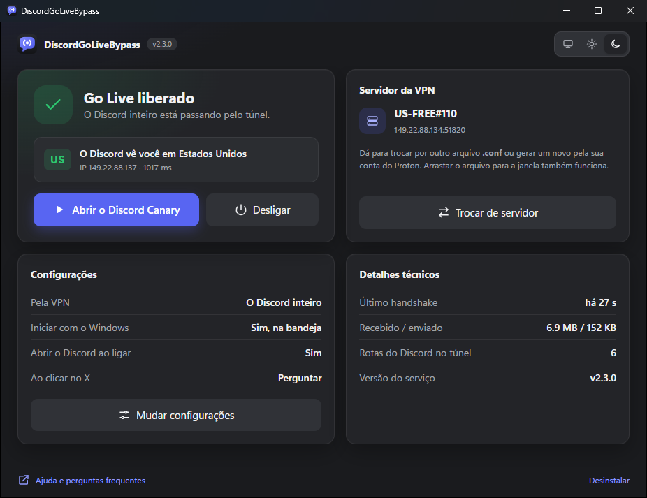
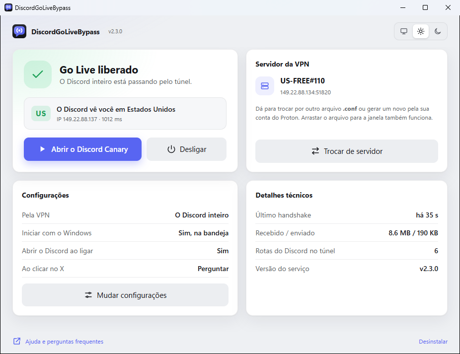

<div align="center">


# DiscordGoLiveBypass

**Leva só o Discord por uma VPN fora do Brasil e devolve o Go Live, a câmera e a transmissão de tela.**

[](../../releases/latest)
[](../../releases)
[](../../actions)
[](LICENSE)


[**Baixar**](../../releases/latest) · [Como usar](#como-usar) · [FAQ](#faq) · [Compilar](#compilar-do-código-fonte)

</div>

Você abre o programa, entra com a sua conta gratuita do Proton VPN ou escolhe um arquivo WireGuard, e clica em Ativar. A partir daí um serviço do Windows mantém um túnel que leva apenas o tráfego do Discord para fora do Brasil, desde que o computador liga. Você abre o Discord pelo atalho de sempre e o Go Live funciona.

<p align="center">
  
  
</p>

> **Windows 10 e 11.** Só o Discord muda de rota: o jogo que você está transmitindo, o navegador e o resto do computador continuam na sua conexão normal. O servidor de saída é o da sua VPN, então a confiança que vale é a que você tem nela.

## Por que o Go Live parou de funcionar

Em 17 de agosto de 2026, a ANPD determinou, em [medida preventiva](https://www.gov.br/anpd/pt-br/assuntos/noticias/em-medida-preventiva-anpd-determina-que-discord-suspenda-transmissoes-ao-vivo-no-brasil), que o Discord suspendesse transmissão de tela e vídeo no Brasil. A decisão veio depois de um caso grave, envolvendo a morte de uma adolescente alvo de uma campanha coordenada de assédio em várias plataformas. O Discord cumpriu a ordem e publicou uma [carta à comunidade brasileira](https://discord.com/blog/a-letter-to-the-discord-community-in-brazil) dizendo que trabalha para restaurar os recursos.

Na prática, para quem está no Brasil:

| parou | continua |
| --- | --- |
| Go Live, transmissão de tela, chamadas de vídeo | mensagens, servidores, canais de voz sem vídeo |

O bloqueio é aplicado por região, e é por isso que sair por um IP de fora o desfaz. Este projeto não opina sobre a decisão da ANPD nem sobre o caso que a motivou: ele muda a rota da sua conexão, como uma VPN faria.

## Por que um túnel, e não mais um proxy

Até a 1.0.4 o programa abria o Discord com `--proxy-server`, apontando para um proxy SOCKS5 gratuito. Isso liberava os botões, mas desviava só o que o Chromium do Discord faz: o gateway, a API e o resto do HTTP. Voz e vídeo saem por outro caminho, o motor de mídia nativo, em UDP, que ignora esse parâmetro, e por isso continuavam saindo do IP brasileiro.

No começo de setembro o Discord passou a recusar essa combinação. A transmissão liberava, mas quem tentava assistir ficava no carregamento e caía em "Stream failed to start", **Erro 2012**, que é o tempo limite de 20 segundos esperando o primeiro quadro de vídeo. Proxy gratuito e Tor não carregam UDP, então nenhum ajuste no modelo antigo resolvia.

Desde a 2.0, o programa liga um túnel WireGuard e põe nele as faixas de IP do Discord: gateway, API, CDN e os servidores de voz e vídeo. Tudo o que o Discord faz sai pelo mesmo IP de fora, UDP incluso. A 2.1 manteve o túnel e trocou a janela preta por um aplicativo de verdade.

## Como usar

### A VPN

O túnel precisa de um servidor WireGuard. O jeito gratuito é uma conta no Proton VPN, criada em [protonvpn.com](https://protonvpn.com). Não precisa instalar o aplicativo do Proton. Com a conta em mãos, há dois caminhos:

- **Entrar com a conta dentro do programa.** Na aba **Entrar com o Proton**, você digita o e-mail e a senha, escolhe o país e o programa gera a configuração sozinho. Se a conta tiver verificação em duas etapas, ele pede o código; se o Proton pedir um CAPTCHA, ele abre numa janelinha.
- **Baixar o arquivo no site.** Em [account.protonvpn.com](https://account.protonvpn.com/downloads), abra **Downloads**, vá até **WireGuard configuration**, escolha **Windows** e um servidor gratuito fora do Brasil, clique em **Create** e baixe o `.conf`.

Qualquer outra VPN que entregue um arquivo WireGuard serve do mesmo jeito, e quem já paga uma usa o arquivo dela.

### Da primeira vez

1. Baixe o `.zip` na aba [Releases](../../releases) e extraia numa pasta.
2. Abra o `DiscordGoLiveBypass.exe`.
3. Entre com a conta do Proton, ou deixe a janela achar o `.conf` que você baixou: ele aparece sozinho na lista, vindo da pasta Downloads. Se estiver em outro lugar, arraste para a janela ou clique em **Escolher**.
4. Clique em **Ativar** e responda **Sim** no aviso do Windows. É a única vez que ele pede permissão de administrador: para instalar o serviço que mantém o túnel.

Com a opção marcada, o Discord abre sozinho quando o túnel liga. Se ele já estava aberto, a janela avisa para reiniciar, para as conexões que ele já tinha também passarem pelo túnel.

A instalação copia o programa para Arquivos de Programas e põe um atalho no menu Iniciar. O `.zip` baixado pode ir para a lixeira.

### No dia a dia

Nada. O túnel liga sozinho quando o Windows inicia, e você abre o Discord pelo atalho de sempre.

A janela serve para ver e mexer: mostra em que país o Discord vê você, liga e desliga o túnel, troca o servidor e abre o Discord. Minimizar esconde a janela na bandeja, perto do relógio, e o menu do ícone faz as mesmas coisas. O tema claro, escuro ou o do Windows se escolhe no canto de cima.

O X pergunta o que você quer: deixar o programa na bandeja, com o túnel ligado e o Go Live funcionando, ou desligar o túnel e fechar. Marcando **Não perguntar de novo**, a escolha vira o padrão, e dá para trocá-la nas preferências.

## Antes de confiar no arquivo

O Windows vai avisar que o programa não tem assinatura digital, e desconfiar de `.exe` baixado da internet é o instinto certo.

O binário não é montado na máquina de ninguém: o GitHub Actions compila a partir deste código, com log público na aba **Actions**, e cada release traz um `SHA256SUMS.txt` gerado no mesmo build. Para conferir o que você baixou:

```
Get-FileHash DiscordGoLiveBypass.exe -Algorithm SHA256
```

Se não bater com a linha correspondente do `SHA256SUMS.txt`, apague o arquivo. E quem preferir não confiar em binário nenhum pode [compilar](#compilar-do-código-fonte), com um comando só.

Dentro do executável vai o driver WireGuardNT, o mesmo que o cliente oficial do WireGuard para Windows usa, sem nenhuma modificação. Ele é baixado no build do site oficial e só entra se o hash bater com o que o próprio cliente oficial fixa, e vem assinado pela WireGuard LLC.

Ao abrir, a janela consulta a API pública do GitHub só para saber se existe uma versão mais nova, e mostra um aviso quando existe. Ela nunca baixa nem troca nada sozinha. Nada é enviado nessa consulta, nem identificador nem informação da máquina.

## FAQ

### No dia a dia

<details>
<summary><strong>Preciso de conta numa VPN?</strong></summary>
<br>

Precisa de um servidor WireGuard, e a conta gratuita do Proton VPN é o jeito mais simples de ter um. A conta é sua e o arquivo também: o programa não traz chave embutida, porque uma chave dividida entre milhares de pessoas derruba a conexão de todas (o WireGuard trata cada chave como um aparelho só) e ainda poria o tráfego de todo mundo na conta de uma pessoa.
</details>

<details>
<summary><strong>Por que não usar uma VPN comum direto?</strong></summary>
<br>

Dá, e funciona. A diferença é que a VPN comum leva o computador inteiro: o jogo que você está transmitindo ganha ping, e banco, streaming e downloads passam a sair pelo servidor dela. Aqui só o Discord vai pelo túnel. Se você não se importa de pôr tudo na VPN, ela resolve com o mesmo esforço.
</details>

<details>
<summary><strong>Preciso abrir o programa toda vez?</strong></summary>
<br>

Não. O túnel fica num serviço do Windows, que liga sozinho com o computador. A janela só é necessária para ativar da primeira vez, ver o estado ou trocar alguma coisa.
</details>

<details>
<summary><strong>O que fica instalado no meu computador?</strong></summary>
<br>

Um serviço chamado `DiscordGoLiveBypass`, o programa em `C:\Program Files\DiscordGoLiveBypass`, um atalho no menu Iniciar e o adaptador de rede do túnel, com o driver WireGuardNT. A configuração da VPN, com a chave, fica em `C:\ProgramData\DiscordGoLiveBypass`, numa pasta que só o sistema e os administradores leem. O tema e as outras escolhas da janela ficam em `%APPDATA%\DiscordGoLiveBypass`.

**Desinstalar**, no canto de baixo da janela, remove tudo isso, inclusive o driver.
</details>

<details>
<summary><strong>Vai ficar lento?</strong></summary>
<br>

O Discord passa a dar a volta pelo servidor da VPN, então o ping dele sobe um pouco, mais ou menos o quanto o servidor está longe. O resto do computador não muda. O plano gratuito do Proton tem velocidade média e servidores às vezes cheios; se a chamada engasgar, gere um arquivo com outro servidor e arraste para a janela.
</details>

<details>
<summary><strong>Funciona no Discord estável, PTB e Canary?</strong></summary>
<br>

Nos três. O túnel pega o tráfego de qualquer um deles, e também o do Discord no navegador. O botão "Abrir o Discord" abre o que já estiver aberto ou, se nenhum estiver, o primeiro instalado: estável, depois PTB, depois Canary.
</details>

<details>
<summary><strong>É seguro digitar a senha do Proton no programa?</strong></summary>
<br>

A senha não sai do computador nem é gravada. O login usa o SRP do Proton, o mesmo do app oficial: o programa só prova ao Proton que conhece a senha, sem enviá-la. Com a sessão aberta, ele gera um par de chaves, pede ao Proton um certificado para a chave pública, monta a configuração e encerra a sessão na hora. O que fica é só a configuração, igual à que o site entregaria, guardada na pasta protegida do serviço.

Uma ressalva honesta: o Proton não tem uma API pública para programas de terceiros. O programa fala com a mesma API do app oficial para Linux e se apresenta como ele, como fazem outras ferramentas da comunidade. Se um dia o Proton mudar isso, o login para de funcionar até sair uma versão nova, e o caminho do arquivo `.conf` baixado no site continua valendo.
</details>

<details>
<summary><strong>O Proton pediu uma verificação</strong></summary>
<br>

De vez em quando o Proton pede um CAPTCHA no login. Ele abre numa janelinha separada, com a página oficial do Proton. Resolvido, a janelinha fecha sozinha e o login continua de onde parou.
</details>

<details>
<summary><strong>Quero trocar de servidor ou de VPN</strong></summary>
<br>

Clique em **Trocar de servidor**. Na tela que abre, você escolhe outro arquivo `.conf` ou entra com a conta do Proton e escolhe o país; arrastar um arquivo para a janela abre a mesma tela. Depois de confirmar a troca, o túnel passa a usar o novo servidor na hora.

A configuração gerada pela conta tem validade: o programa pede um ano ao Proton, e a data que ele concedeu aparece na janela quando ela é criada. Depois disso, é só gerar outra.
</details>

<details>
<summary><strong>Eu usava a 2.0, o que muda?</strong></summary>
<br>

O `.bat`, a janela preta e a permissão de administrador a cada abertura saíram. Abra a 2.1 uma vez: ela acha sozinha o arquivo que a 2.0 tinha guardado, e depois de ativar você não precisa mais dela no dia a dia. O atalho "Discord sem bloqueio" da 2.0 pode ser apagado.
</details>

### Quando dá errado

<details>
<summary><strong>A janela mostra "Servidor sem resposta"</strong></summary>
<br>

O servidor da VPN parou de responder. Enquanto isso, o serviço tira o Discord do túnel, para ele continuar funcionando, só sem Go Live. Quando o servidor volta, o túnel volta sozinho. Se demorar, gere um arquivo com outro servidor no site da VPN e arraste para a janela.
</details>

<details>
<summary><strong>A janela mostra "O Discord ainda vê o Brasil"</strong></summary>
<br>

O túnel está ligado, mas o servidor escolhido não tirou você do Brasil. Gere um arquivo com um servidor de outro país e troque pela janela.
</details>

<details>
<summary><strong>Apareceu "não é uma configuração WireGuard válida"</strong></summary>
<br>

O arquivo está incompleto ou não é de WireGuard. Arquivo de OpenVPN (`.ovpn`) não serve. Gere de novo no site da VPN, na opção de WireGuard.
</details>

<details>
<summary><strong>Apareceu que a permissão de administrador foi negada</strong></summary>
<br>

O aviso do Windows foi respondido com Não ou fechado. Clique em Ativar de novo e responda Sim. Se a sua conta não for administradora, o Windows pede a senha de uma que seja.
</details>

<details>
<summary><strong>Apareceu "não consegui criar o adaptador de rede do túnel"</strong></summary>
<br>

O Windows recusou o driver ou o adaptador. Antivírus com proteção de rede costuma ser o motivo: adicione o `DiscordGoLiveBypass.exe` de Arquivos de Programas às exceções. Outro app de VPN ligado ao mesmo tempo também pode atrapalhar; desligue-o e tente de novo.
</details>

<details>
<summary><strong>O Go Live continua bloqueado ou dá Erro 2012</strong></summary>
<br>

Confira três coisas. Plugin de bypass ativo no Vencord ou BetterDiscord mexe na conexão depois que o Discord abre e pode desfazer o túnel: desative e tente de novo. Quem assiste também precisa estar com o Go Live liberado, por este programa ou por uma VPN. E o `Validar-rota.ps1`, que vem no `.zip`, mostra se a voz e o vídeo estão mesmo saindo pelo adaptador `DiscordGoLiveBypass`.
</details>

<details>
<summary><strong>Como mandar informação útil numa issue</strong></summary>
<br>

Com o Discord aberto, clique com o botão direito no `Validar-rota.ps1`, escolha **Executar com o PowerShell** e cole o resultado na issue, junto de um print da janela. Nada ali mostra a chave da VPN. O registro da janela fica em `%APPDATA%\DiscordGoLiveBypass\janela.log`.
</details>

### Segurança e risco

<details>
<summary><strong>É seguro?</strong></summary>
<br>

O tráfego do Discord passa pelo servidor da VPN que você escolheu, criptografado pelo WireGuard até lá. A chave fica só no seu computador, numa pasta que só o sistema e os administradores leem. A janela só entrega a chave ao serviço depois de conferir que o canal entre os dois pertence mesmo ao sistema, e nada no programa mostra ou registra a chave, nem em mensagem de erro.
</details>

<details>
<summary><strong>Vou tomar ban?</strong></summary>
<br>

O programa muda a rota da sua conexão, não modifica o Discord nem automatiza nada. É o mesmo que usar uma VPN, coisa que muita gente faz sem problema. Ainda assim não existe garantia, e a decisão é sua.
</details>

<details>
<summary><strong>Meu antivírus reclamou</strong></summary>
<br>

Programa novo, sem assinatura digital, que instala um serviço e cria adaptador de rede: é o retrato do que antivírus desconfia. O código está todo aqui, o binário sai do GitHub Actions com log público e cada release traz as somas SHA256.
</details>

## Como funciona por dentro

Um executável só faz três papéis. Aberto normalmente, é a janela, feita com o [Wails](https://wails.io): HTML e JavaScript simples, desenhados pelo navegador embutido do Windows (WebView2), e o resto em Go. Com `-service`, é o serviço do Windows que mantém o túnel. E com `-install` ou `-uninstall`, é o passo que a janela roda com administrador para instalar ou remover esse serviço.

O serviço roda como sistema a partir de Arquivos de Programas, onde só administrador escreve. Ele cria um adaptador com o driver WireGuardNT e põe nele só as faixas do Discord, conferidas no registro do RIPE e no DNS: `66.22.192.0/18` e `195.62.89.0/24`, onde ficam os servidores de voz e vídeo, um bloco por região, e `162.159.128.0/20`, o trecho da Cloudflare com gateway, API e CDN, mais os equivalentes em IPv6. Rota mais específica vence a rota padrão, então só esse tráfego entra no túnel, e o Windows escolhe isso sozinho para qualquer programa, inclusive o motor de mídia nativo do Discord.

As rotas só entram depois que o servidor da VPN responde ao primeiro handshake, e saem se ele passar três minutos sem responder. Um servidor fora do ar nunca deixa o Discord sem conexão: no máximo sem Go Live, até ele voltar.

A janela e o serviço conversam por um named pipe que só aceita o sistema, os administradores e o usuário que instalou. Antes de mandar a chave da VPN, a janela confere que o dono do pipe é o sistema, para nenhum outro programa poder se passar pelo serviço. Para mostrar o país, a janela pergunta ao gateway do Discord, em `gateway.discord.gg/cdn-cgi/trace`, com que IP e de que país você chega. É o IP do gateway que decide o que a conta pode fazer, e o pedido faz o mesmo caminho que o app.

O login do Proton roda na janela, sem administrador. Ele faz o SRP com a [biblioteca do próprio Proton](https://github.com/ProtonMail/go-srp), escolhe na lista do Proton o servidor gratuito de menor pontuação fora do Brasil, gera um par de chaves Ed25519, pede um certificado para a chave pública e deriva dela a chave X25519 que o WireGuard usa, a mesma conta que a biblioteca de VPN do Proton faz. A configuração vai para o serviço pelo mesmo pipe de um arquivo importado e não passa pelo disco do usuário. O CAPTCHA do Proton se recusa a ser mostrado dentro de outra página, mas foi feito para rodar num WebView2, então abre numa janela própria, num processo separado: se algo der errado ali, só a janelinha fecha.

## Compilar do código-fonte

Precisa do [Go](https://go.dev/dl/). No PowerShell, na pasta do projeto:

```
.\Compilar.ps1
```

É o mesmo script que a release usa: baixa o WireGuardNT do site oficial, confere o hash, embute o driver, o ícone e a identificação no executável e compila com as tags que o Wails pede. Não precisa do Node nem do CLI do Wails: a página da janela é HTML, CSS e JavaScript sem etapa de build.

| arquivo | conteúdo |
| --- | --- |
| `main_windows.go` | escolhe entre janela, serviço, instalação e remoção |
| `gui_windows.go` | métodos que a página chama, preferências e tema |
| `frontend/` | a página da janela |
| `tray_windows.go` | ícone na bandeja, direto na API do Windows |
| `service_windows.go` | serviço, instalação, remoção e a pasta protegida da configuração |
| `engine_windows.go` | adaptador WireGuardNT, rotas e acompanhamento do handshake |
| `state.go` | quando pôr e tirar as rotas, em funções puras |
| `ipc.go`, `ipc_windows.go` | canal entre a janela e o serviço |
| `wgconf_windows.go` | leitura e validação do `.conf`, sem expor a chave |
| `routes.go` | faixas de IP do Discord e resolução dos domínios |
| `trace.go` | país e IP que o Discord enxerga |
| `wgfile.go` | busca do `.conf` nos Downloads |
| `discord.go` | detecção da instalação e abertura do Discord |
| `elevate_windows.go` | pedido de administrador e lista de processos |
| `update.go` | consulta da última release no GitHub |
| `proton.go` | login no Proton, lista de servidores, certificado e montagem da configuração |
| `gui_proton_windows.go` | o login do Proton visto pela janela |
| `captcha_windows.go` | janelinha do CAPTCHA, com um WebView2 só dela |

Os testes rodam sem rede e sem administrador:

```
go test ./...
```

Dois testes mexem em coisa de verdade e só rodam quando pedido: `DGLB_REDE=1` consulta o Discord, e `DGLB_BANDEJA=1` põe um ícone de teste na bandeja.

## Créditos

A ideia de passar o Discord inteiro por um túnel WireGuard, em vez de só o gateway por um proxy, veio do **[GoLiveBypass](https://github.com/bezumiya/GoLiveBypass)**, que resolve o mesmo problema com interface gráfica e plugin para Vencord. Este projeto faz por fora, sem tocar na instalação do Discord. Por isso a licença aqui é a mesma dele, GPL-3.0.

O caminho do login no Proton, com os endereços da API, os códigos de erro e o formato do certificado, segue o **[protonvpn-wg-confgen](https://github.com/hatemosphere/protonvpn-wg-confgen)**, também GPL-3.0.

O túnel usa o driver WireGuardNT e as bibliotecas `wireguard-windows` e `wireguard-go`, da WireGuard LLC, a janela usa o Wails e o login usa o `go-srp` do Proton, cada um sob a sua licença. A do driver vai junto no `.zip`, em `LICENCA-WireGuardNT.txt`. WireGuard é marca registrada de Jason A. Donenfeld, e este projeto não tem relação com ele.
